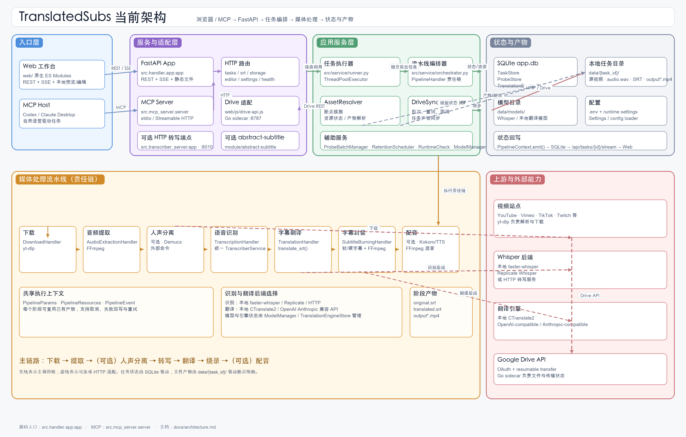
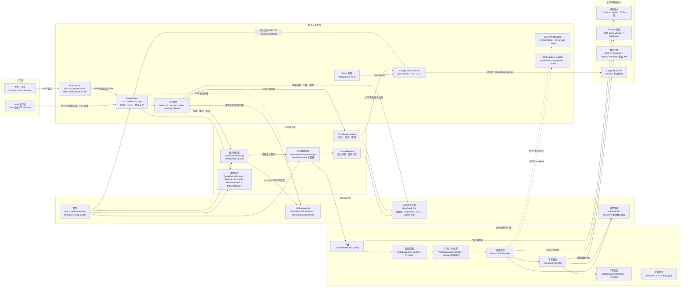

# TranslatedSubs 当前架构

这张图按当前源码组织，展示入口、服务适配、任务编排、核心媒体处理、持久化和可选外部服务之间的关系。

任务主链路是：`POST /api/tasks` 或上传接口创建 `PENDING` 记录，`runner` 把任务提交到线程池，`orchestrator` 按“下载 → 提取 →（可选）人声分离 → 转写 → 翻译 → 烧录 →（可选）配音”执行。每个阶段通过 `PipelineContext.emit()` 回写 SQLite，Web 端从 `/api/tasks/{id}/stream` 订阅 SSE；阶段产物保存在 `data/{task_id}/`，因此服务重启后可以按已有产物断点续跑。

MCP Server 只做业务 API 适配，不直接访问 SQLite 或核心流水线。Google Drive sidecar 也保持进程隔离：Python 服务负责任务和产物，Go sidecar 负责 OAuth、Google Drive 文件操作与断点传输，导入本地任务时再通过 HTTP 调用 Python 的上传接口。
