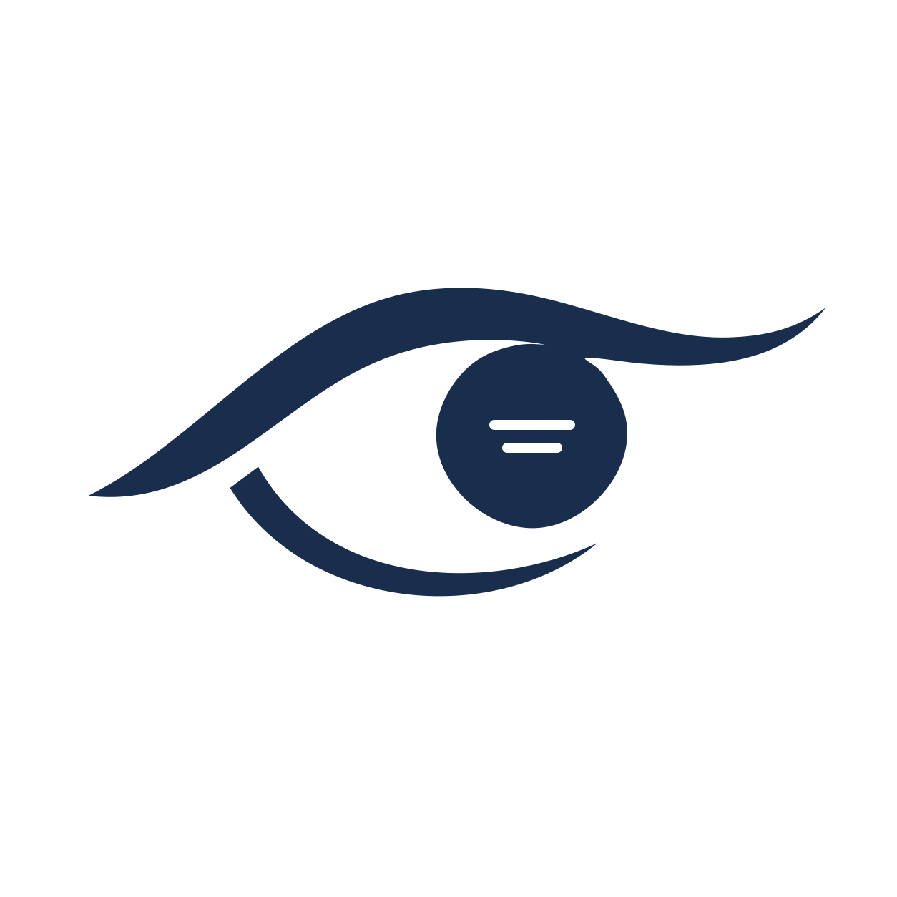
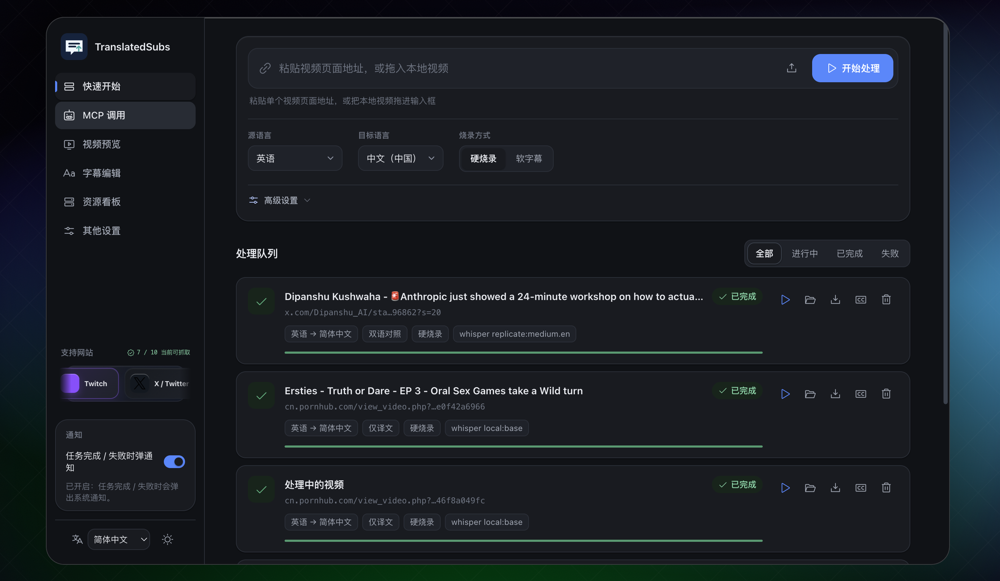
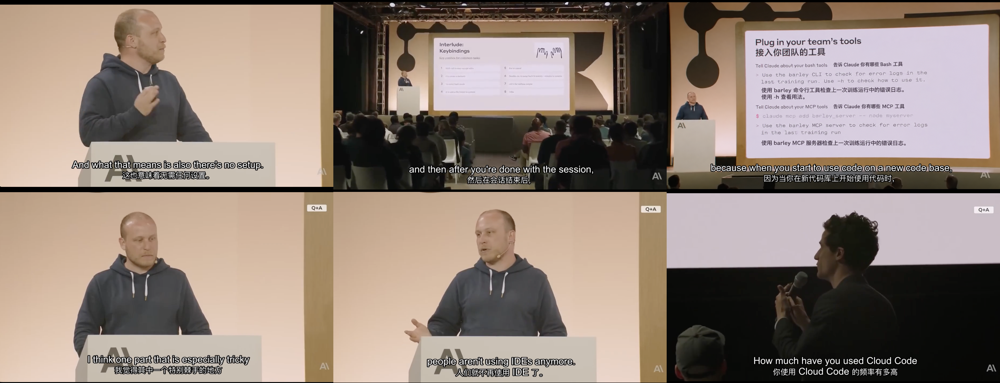

[English](../../README.md) | [简体中文](../zh/README.md) | [हिन्दी](../hi/README.md) | Español | [Français](../fr/README.md) | [Português](../pt/README.md) | [Русский](../ru/README.md)

<div align="center">
  
  <h1>TranslatedSubs</h1>
  <p><strong>Comprende tanto la voz como el texto en pantalla: transcripción, traducción de subtítulos y reconocimiento de contenido escrito en pizarras.</strong></p>
  <p>Implementación rápida e integración con MCP.</p>
</div>

TranslatedSubs es un espacio de trabajo para comprender vídeo y audio: descarga contenido, transcribe voz, traduce subtítulos y reconoce texto escrito que aparece en los vídeos.

- **Vídeos de múltiples fuentes**: descarga directamente desde las plataformas compatibles, sin tener que descargar y volver a subir los archivos manualmente.
- **Despliegue local y modelos flexibles**: inicia el sistema rápidamente o usa una configuración ligera; configura modelos más avanzados para mejorar la correspondencia, incluidos modelos de la comunidad.
- **Tareas paralelas y recursos visibles**: ejecuta varios trabajos a la vez y consulta su estado y consumo de recursos. También se puede sincronizar con Google Drive.
- **Servicio independiente de ajuste fino**: ajusta los modelos compatibles mediante un servicio separado para mejorar los resultados según tus necesidades.
- **Uso en varios dispositivos**: disponible en la web, Windows y macOS; el soporte para móviles está previsto para el futuro.

Plataformas de vídeo compatibles:
[](https://www.youtube.com/)
[](https://vimeo.com/)
[](https://www.dailymotion.com/)
[](https://www.twitch.tv/)
[](https://www.tiktok.com/)
[](https://x.com/)
[](https://www.instagram.com/)
[](https://www.acfun.cn/)
[](https://www.nicovideo.jp/)
[](https://www.pornhub.com/)





## Compilar desde el código fuente

### Dependencias necesarias

Para ejecutar desde el código fuente necesitas Python 3.10–3.12, `uv`, Git (solo para clonar el repositorio), FFmpeg/FFprobe con el filtro `subtitles` (libass) para incrustar subtítulos y un servicio Redis en ejecución. `uv sync` instala las bibliotecas de Python, incluido el cliente Redis (`redis>=5`), pero no instala ni inicia el servidor Redis. Si ya tienes un Redis remoto, configura su dirección en `redis.url` de `config.local.json` y no instales otro servidor. Go 1.23 o posterior solo se necesita para el sidecar de Google Drive; Node.js solo para las pruebas del frontend. Estas funciones opcionales no son necesarias para iniciar; instala solo las que vayas a usar (puedes combinar varias opciones en un mismo comando):

- `uv sync --extra local-translation`: traducción local, de inglés a chino de forma predeterminada.
- `uv sync --extra hf-models`: modelos Whisper de Hugging Face.
- `uv sync --extra tts`: doblaje con Kokoro; también requiere `espeak-ng` instalado en el sistema (consulta [TTS](../tts.md)).

Instalar los paquetes de Python no incluye los pesos de los modelos: antes de la primera tarea, descarga o importa desde Configuración los modelos de traducción local y Whisper y comprueba que estén listos. Kokoro descarga sus pesos la primera vez que se genera voz. Demucs se instala por separado solo si habilitas la separación de voz.

### Compilación en macOS

Para ejecutar el proyecto localmente en macOS necesitas Python 3.10–3.12, `uv` y FFmpeg con soporte para libass. La API también sirve el espacio de trabajo web, así que no hace falta instalar Node.js por separado.

Ejecuta estos comandos en un directorio adecuado:

```sh
git clone https://github.com/S-zhi/TranslatedSubs.git
cd TranslatedSubs
brew install uv redis
brew tap homebrew-ffmpeg/ffmpeg
brew install ffmpeg-full
uv sync
cp config.example.json config.local.json
brew services start redis
redis-cli ping
```

El último comando debe responder `PONG`. Ejecútalo antes de iniciar la API.

Configura las credenciales de modelos y los ajustes del servicio en la interfaz o mediante la API después del inicio; se guardan en Redis y no requieren reiniciar el servicio.

Inicia la API y el espacio de trabajo web:

```sh
uv run python -m src.cli
```

Abre <http://127.0.0.1:8000/>. Comprueba el servicio y que FFmpeg incluya el filtro para subtítulos incrustados:

```sh
curl http://127.0.0.1:8000/api/health
curl http://127.0.0.1:8000/api/health/ready
ffmpeg -hide_banner -filters | grep " subtitles "
```

### Compilación en Windows

En Windows 10 u 11, puedes ejecutar TranslatedSubs desde el código fuente con PowerShell. El proyecto admite Python 3.10–3.12; estos pasos usan Python 3.12 e instalan las versiones fijadas en `uv.lock`. La API sirve el espacio de trabajo web, por lo que no necesitas instalar Node.js por separado.

1. Instala `uv`:

   ```powershell
   powershell -ExecutionPolicy ByPass -c "irm https://astral.sh/uv/install.ps1 | iex"
   ```

   Cuando termine la instalación, vuelve a abrir PowerShell.

2. Instala FFmpeg. En la [página de descargas de FFmpeg](https://ffmpeg.org/download.html), elige una compilación para Windows y descarga la versión completa de Gyan. Descomprímela y añade su directorio `bin` (por ejemplo, `C:\ffmpeg\bin`) a `PATH`; después, vuelve a abrir PowerShell. Comprueba que estén disponibles `ffmpeg`, `ffprobe` y el filtro para subtítulos incrustados:

   ```powershell
   ffprobe -version
   ffmpeg -hide_banner -filters | findstr /i subtitles
   ```

3. Clona el proyecto, instala las dependencias y crea la configuración local:

   ```powershell
   git clone https://github.com/S-zhi/TranslatedSubs.git
   cd TranslatedSubs
   uv python install 3.12
   uv sync --python 3.12 --locked
   Copy-Item config.example.json config.local.json
   ```

4. Prepara Redis con Docker Desktop para contenedores Linux. Si ya tienes un Redis remoto, puedes configurar su dirección en `redis.url` de `config.local.json` y omitir este paso.

   ```powershell
   docker run -d --name translatedsubs-redis --restart unless-stopped -p 127.0.0.1:6379:6379 -v translatedsubs-redis-data:/data redis:7-alpine redis-server --appendonly yes
   docker exec translatedsubs-redis redis-cli ping
   ```

   La segunda orden debe responder `PONG`.

   Configura las credenciales de modelos y los ajustes del servicio en la interfaz o mediante la API después del inicio; se guardan en Redis y no requieren reiniciar el servicio.

Inicia la API y el espacio de trabajo web:

```powershell
uv run --locked python -m src.cli --host 127.0.0.1 --port 8000
```

Abre <http://127.0.0.1:8000/>. Comprueba el servicio con:

```powershell
curl.exe http://127.0.0.1:8000/api/health
curl.exe http://127.0.0.1:8000/api/health/ready
```

## Inicio rápido con Docker

Ejecuta lo siguiente desde la raíz del repositorio:

```bash
cp config.example.json config.local.json
```

Edita `config.local.json` para que la API use Redis de Compose y los volúmenes `/data`:

```json
{
  "redis": {
    "url": "redis://redis:6379/0",
    "namespace": "translatedsubs-local"
  },
  "paths": {
    "dataDir": "/data",
    "dbPath": "/data/db/app.db"
  },
  "http": {
    "host": "0.0.0.0",
    "port": 8000
  }
}
```

Después inicia los servicios:

```bash
# El traductor local predeterminado no necesita una clave API; configura claves en la nube solo cuando las necesites.
docker compose up -d --build
```

Compose descarga e inicia la API y Redis; no necesitas instalar Redis, Python, `uv` ni FFmpeg en el equipo anfitrión. Conserva los volúmenes persistentes de Redis y datos al actualizar. La imagen predeterminada incluye solo las dependencias básicas; para usar extras opcionales, instala los extras y paquetes de sistema necesarios en el `Dockerfile` y reconstruye la imagen. Los pesos de los modelos se descargan por separado. Si actualizas desde una versión que usaba `.env`, sigue primero la guía de [migración desde .env](../local-quick-start.md) antes de iniciar la API.

Abre <http://localhost:8000/>. Ejecuta `curl http://127.0.0.1:8000/api/health` para comprobar que la API responde; la respuesta correcta contiene `"ok":true`. `/api/health/ready` muestra además el estado de la clave de traducción, FFmpeg, el almacenamiento y el filtro de subtítulos integrados. Para el desarrollo local y la implementación en Linux, consulta el [índice de documentación (en chino)](../README.md).

## Funcionalidades

- **Procesamiento de subtítulos**: Descarga vídeos, extrae audio, transcribe y traduce la voz, y genera subtítulos independientes o integrados en el vídeo.
- **Interfaz web**: Gestiona la cola de tareas, sigue el progreso, previsualiza vídeos, edita subtítulos y descarga los resultados en el navegador.
- **Interfaz multilingüe**: Cambia desde la barra lateral entre chino simplificado, inglés, hindi, español, árabe, francés, portugués y ruso. La selección se guarda en el navegador; en la primera visita se usa el idioma del navegador, salvo que el despliegue haya definido otro idioma predeterminado. Este se configura con `UI_LOCALE` en `web/config.js`.
- **Integración MCP**: Permite que Codex, Claude Desktop y otros clientes de IA creen y sigan tareas mediante lenguaje natural.
- **Extensión de Google Drive**: Sube, descarga y organiza archivos por tarea para compartir los resultados con un equipo.

## Del vídeo a los subtítulos

1. Pega la URL de una página de vídeo en la interfaz web o sube un vídeo local. Puedes comprobar primero la URL con la prueba de descarga.
2. Elige los idiomas de origen y destino, subtítulos solo traducidos o bilingües, y subtítulos separados o integrados. La transcripción utiliza faster-whisper local por defecto. Antes del primer trabajo, descarga el modelo elegido en la sección de modelos locales y espera a que esté listo.
3. Envía el trabajo y sigue en la cola la descarga, extracción de audio, transcripción, traducción e integración. Al terminar, puedes previsualizar el vídeo, editar los subtítulos, volver a integrarlos y descargar el vídeo y el SRT. El modo de solo descarga no genera subtítulos.

Los subtítulos separados se pueden activar o desactivar en el reproductor. Los integrados quedan grabados en la imagen y requieren el filtro `subtitles` (libass) de FFmpeg. La primera ejecución puede necesitar descargar un modelo y acceder a servicios externos. Los clientes de IA pueden seguir el mismo flujo mediante la [guía de agentes MCP (en chino)](../mcp-agent-guide.md).

## Configuración y datos

Copia `config.example.json` como `config.local.json` e inicia Redis. Configura las credenciales de modelos y los ajustes del servicio en Configuración o mediante la API de configuración. Los valores se guardan en Redis y se aplican a las nuevas solicitudes sin reiniciar el servicio.

El archivo de arranque contiene los ajustes locales de Redis, rutas de datos y escucha. Conserva los volúmenes de datos y Redis al actualizar. No incluyas `config.local.json`, `.env`, cookies, credenciales OAuth ni archivos multimedia de prueba en el repositorio. Google Drive requiere un sidecar independiente; consulta el [inicio rápido local (en chino)](../local-quick-start.md).

## Problemas frecuentes

- La API responde pero los trabajos no empiezan: revisa `checks` y `capabilities` en `/api/health/ready` para comprobar la clave, FFmpeg/FFprobe, yt-dlp y el almacenamiento.
- `MODEL_NOT_READY`: descarga y comprueba el modelo Whisper elegido en la sección de modelos locales.
- No funcionan los subtítulos integrados: instala FFmpeg con libass o selecciona subtítulos separados. Comprueba el filtro con `ffmpeg -hide_banner -filters | grep ' subtitles '`.
- Falla la descarga de una URL: ejecuta primero la prueba de descarga; si el sitio exige inicio de sesión, configura cookie file setting según la [guía local (en chino)](../local-quick-start.md).

## Documentación

La mayoría de las guías siguientes están en chino; el protocolo del servicio de transcripción está en inglés.

- [Índice de documentación](../README.md): guías de implementación y extensiones por caso de uso.
- [Inicio rápido local](../local-quick-start.md): macOS/Linux, variables de entorno y Google Drive sidecar.
- [Implementación en Linux](../quick-start-linux.md): instalación en Ubuntu/Debian, systemd, proxy inverso y resolución de problemas.
- [Servidor MCP](../mcp-server.md): stdio, Streamable HTTP y herramientas.
- [Guía de agentes MCP](../mcp-agent-guide.md): secuencia de llamadas, estados y errores.
- [Google Drive sidecar](../../drive-service/README.md): API y configuración para sincronizar archivos en la nube.

## Desarrollo

El proyecto utiliza Python 3.10–3.12, FastAPI, FFmpeg y JavaScript nativo. Para desarrollarlo localmente, ejecuta `uv sync` y después `uv run python -m src.cli`; el mismo servicio publica la interfaz web. Ejecuta las pruebas de Python con `uv run pytest -q` y las pruebas del frontend con `npm test` desde `web/`. Las pruebas con servicios reales requieren activación explícita; consulta [AGENTS.md (en chino)](../../AGENTS.md).

`src/handler/` expone la API HTTP; `src/core/` procesa descargas, transcripción y subtítulos; `src/service/` y `src/store/` gestionan tareas y persistencia; `src/mcp_server/` proporciona MCP; y `web/` contiene la interfaz. Consulta [CONTRIBUTING.md (en chino)](../../.github/CONTRIBUTING.md). Comunica las vulnerabilidades de forma privada según [SECURITY.md](../../.github/SECURITY.md), nunca en un Issue público.

## Licencia y cumplimiento

El proyecto se distribuye bajo la [licencia MIT](../../LICENSE). Procesa únicamente contenido que tengas derecho a acceder, descargar, transcribir, traducir y redistribuir. Respeta las condiciones del sitio de origen, las restricciones de derechos de autor y la legislación aplicable.
