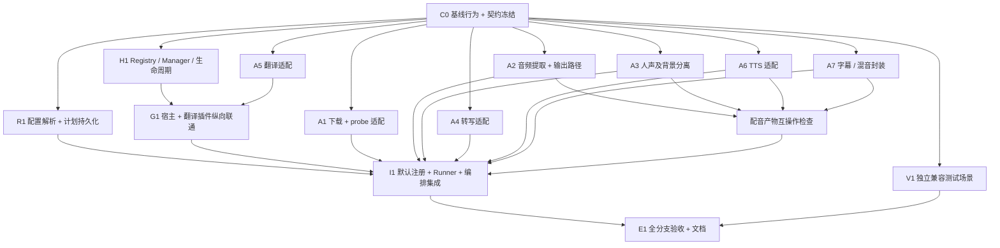
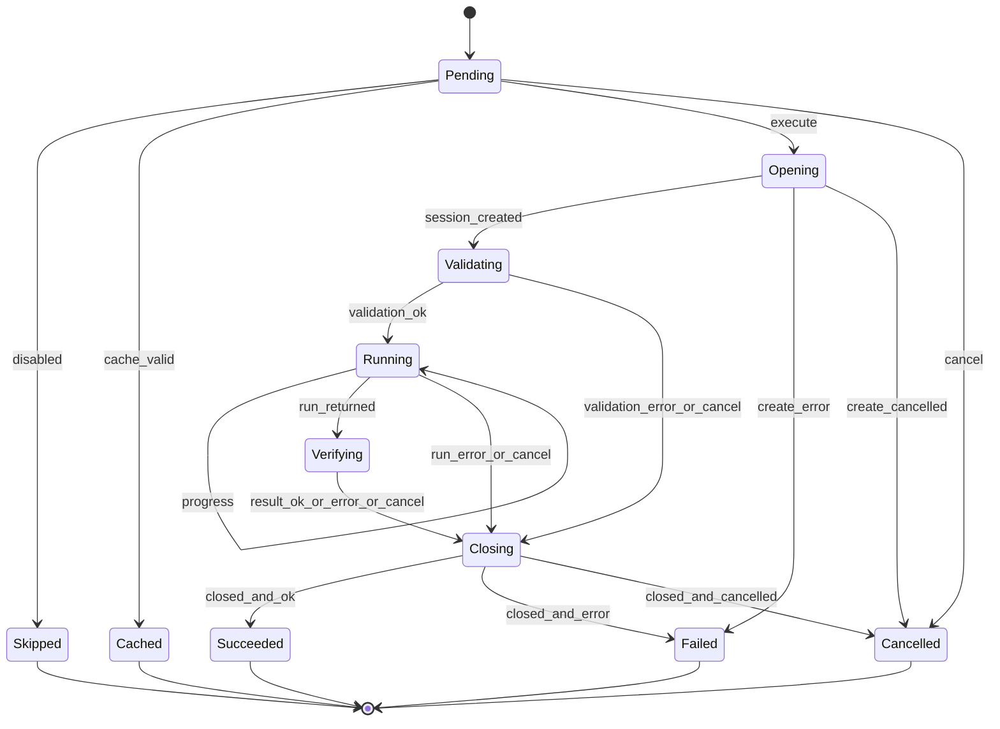
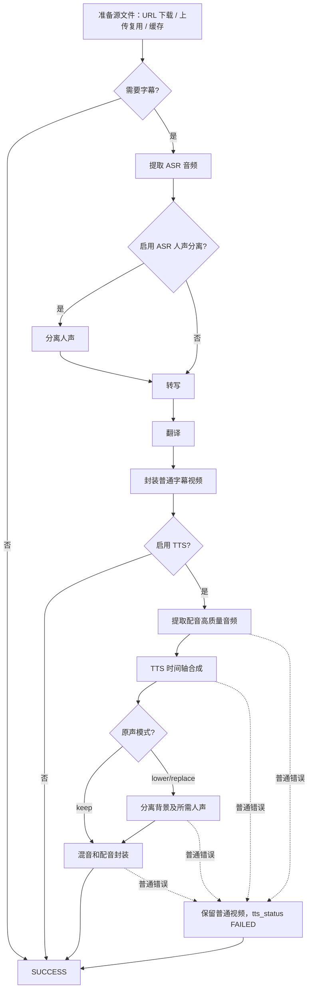

# Pipeline Plugin v1：后端改造与 Agent 并行开发方案

状态：设计稿，尚未实施。核对基线：工作树 `71e5/TranslateSub`，提交 `c5a8e40`。

## 1. 目标与交付边界

第一期只开发后端：把下载、音频提取、人声分离、转写、翻译、TTS、字幕及音视频封装七种能力接入同一个插件宿主。前端继续提交现有参数，沿用现有 REST、SSE、状态值和下载地址。

第一期完成标准：编排器通过宿主执行所有七类能力，能在测试中替换任一插件；默认插件保持当前任务行为；旧任务仍能恢复；插件选择可通过后端配置替换并在创建任务时固定。不交付插件市场、安装上传、动态卸载、任意 Python 代码加载、通用插件配置页面或运行时热切换。

“只改后端”的限制是：用户暂时不能在页面上管理任意新插件。若要页面新增下载器选择、插件实例 CRUD 或实时切换，则属于后续前后端联合开发。

当前代码事实：

- `src/service/orchestrator.py` 有六个默认 Handler；TTS 嵌在 `SubtitleBurningHandler._add_dubbed_video`，并不是独立 Handler。
- 配音分支直接调用 FFmpeg、背景声分离和 TTS。只替换六个顶层函数调用不能完成插件化。
- `src/service/runner.py` 从 `TranslationEngineStore` 读取翻译配置。本工作树没有 `model_runtime.py`；生命周期代码实际在 `src/service/task/task_lifecycle.py`。不能直接套用其他工作树的模块路径。
- `src/core/audio_extractor.py:extract_audio` 固定输出 `audio.wav`；配音准备需要单独的 `tts_source.wav`，必须解决输出路径契约。

本次只读核对源码并编写方案，没有运行测试或修改业务符号。当前没有可调用的 GitNexus / Context7 工具，也没有本地 `.gitnexus` 索引；不将源码核对声称为图谱分析。实施时按仓库要求恢复这些工具，修改现有符号前执行 impact，提交前执行 detect_changes；HIGH/CRITICAL 先报告。需要第三方 API 文档或生成实现代码时使用 Context7。

## 2. 能力、执行节点和职责

七类插件是能力分类，不限制一项任务只能调用七次。建议保留现有主流程顺序，先产出普通视频，再执行可选配音分支，避免同时重写调度方式。

| 稳定 stage ID | 强类型请求 → 结果 | 边界与复用 |
|---|---|---|
| `download` | DownloadRequest → DownloadResult | URL、清晰度 → source 路径、标题；附加可选 probe 能力，现有探测接口走同一选择逻辑 |
| `audio_extract` | AudioExtractRequest → AudioExtractResult | source、采样率、声道、目标路径 → audio、实测格式、时长；分别支持 ASR 与配音用途 |
| `vocal_separate` | SeparationRequest → SeparationResult | audio、用途、所需 stems → 人声/背景声路径；ASR 用人声，配音 lower/replace 用背景声及可选人声 |
| `transcribe` | TranscriptionRequest → TranscriptionResult | audio、语言、模型配置 → original_srt |
| `translate` | TranslationRequest → TranslationResult | original_srt、语言对、单双语模式 → translated_srt |
| `tts` | TTSRequest → TTSResult | 原文/译文字幕、音色、目标语言、时长 → speech_audio |
| `render` | SubtitleRenderRequest / DubMuxRequest → 各自结果 | 字幕封装输出普通视频；配音封装接收显式音轨，负责混音和最终封装 |

`render` 有两个明确 operation：`subtitle` 和 `dub_mux`，不是让一个模糊的 request 字典靠字段猜用途。人声分离也显式声明 `purpose=asr|dubbing`、需要哪些 stems，防止缓存混用。

职责分配：

- Handler 决定分支、复用、执行顺序、资源传递、任务事件及 TTS 降级策略；不组装 FFmpeg 命令。
- Manager 负责查找与验证插件、生命周期、标准错误、进度入口、取消检查和结果检查；不直接写任务数据库。
- 插件负责执行具体能力、适配底层回调/异常并报告产物；不自行启动另一个阶段、不发任务成功事件、不修改全局配置。
- AssetResolver 继续负责产物定位与缓存判断；Runner 保留任务持久化、线程池、取消信号与子进程清理。

首期继续使用现有同步线程池。允许不同任务并发；不新增同一任务的阶段并行执行。开发可以并行，不代表运行流程要并行。

## 3. C0 必须冻结的契约

下列约定冻结后，其他任务才能开始真实实现。原方案中的无约束 `inputs/options/outputs` 字典不能充当强类型契约。

### 3.1 接口与身份

- Manifest：`plugin_id`、`stage`、`protocol_version`、`implementation_version`、支持的 operations/capabilities；注册时拒绝重复 ID、阶段不匹配和不支持的协议版本。
- 注册单位为轻量工厂；注册时不加载 Whisper、Demucs、Kokoro，不执行联网检查。首次执行所需阶段才初始化重依赖。
- Session：`create_session(config, context)` → `validate(request)` → `run(request)` → `close()`。每次阶段调用独立 session；成功创建后，不论校验、执行、取消是否失败均调用 close。创建期间失败由工厂清理部分资源。
- 请求为带固定 stage/operation 的 dataclass 或等价强类型对象；Manager 运行时检查输入输出类型，不能只依赖类型提示。
- `plugin_id` 是实现身份，旧 `engine` 是配置记录 ID，两者不能混为一谈。首期将 engine 映射到内置翻译适配器及其配置，不删除原有 TranslationEngineStore。

### 3.2 执行上下文

Context 提供 `task_id`、唯一 `invocation_id`、任务工作目录、取消令牌、阶段进度回调、子进程登记服务、执行时凭据解析。用途区分如 `extract.asr`、`extract.dubbing`、`render.subtitle`、`render.dub_mux`。

取消和进度只放在 Context，避免同时放在 Request 产生两个来源。进度单位统一为 0–100，未知用空值；由兼容层映射到旧 `_BANDS`。插件不得直接发 REST/SSE 事件或自行设置任务 SUCCESS。

取消属于控制流，不是普通 PluginError。转写、人声分离等底层取消异常统一转成取消信号；Manager 在执行前后、结果发布前检查取消。保留现有子进程登记/终止机制；同步 Python 无法安全强杀线程，不把协作取消描述成硬超时保证。

### 3.3 产物、错误与清理

- 结果显式声明必需产物和 metadata。Manager 验证文件存在、非空、路径符合任务目录约定，再交给 Handler 发布；格式检查按阶段增加最低必要验证。
- 输出路径由宿主分配。`audio.wav` 与 `tts_source.wav` 分开，ASR 与配音 stems 分开描述；不隐式覆盖另一次调用的产物。
- 标准错误至少包含稳定 code、stage、plugin_id、脱敏 message、原始 cause；旧外部错误码经兼容映射保留。
- close 失败不能覆盖已有执行异常；执行成功但资源释放失败则报告 cleanup 错误并进入该阶段的失败策略。首期不引入通用自动重试，避免重复下载或重复模型计费。
- 缓存 metadata 包含插件/实现版本、用途、非敏感配置指纹和输入指纹。指纹变化使该产物及依赖它的下游产物失效。不得仅凭文件名判断切换插件后的缓存可复用。
- 旧任务无 metadata 的缓存只沿明确的 legacy 路径复用；显式更换插件或配置后不能继续冒用旧缓存。取消时只清理本次未完成产物，普通成品在配音失败时保留。

### 3.4 配置固定与数据库

建议首期新增任务内部字段 `plugin_plan_json`（名称在 C0 冻结），不新增 `pipeline_plugin_instances` 通用管理表。

创建 URL/上传/MCP 任务时，由唯一 resolver 将旧请求、翻译引擎记录、后端默认插件映射解析为执行计划。计划含 schema 版本、各调用使用的插件 ID/实现版本、非敏感有效配置及凭据引用；与任务创建同次持久化，入队前必须完成。去重复用旧任务时不得覆盖原计划。

Runner 只消费持久化计划，执行时读取当前凭据，不重新选择模型或插件。凭据被删或所需插件版本不可用时明确失败，不能悄悄切换实现。API Key 不进入计划、API 返回、SSE 或普通日志。旧 TaskRecord 的 `to_dict()` 使用 asdict，新增内部字段必须检查所有序列化路径，不能假定它自动隐藏。

旧任务计划为空：按已有记录解析一次并原子保存；不能追溯还原当时未记录的配置，该限制需在迁移说明中明确。重试沿用已固定计划；用户要改变配置应创建新任务。按实际需要的阶段延迟验证依赖，避免仅下载任务要求安装 Whisper/TTS。

若未来合入已有统一 runtime resolver 的其他分支，应复用该 resolver/快照字段并升级 schema，不并行维护两套有效配置解析器。

## 4. 开发依赖 DAG

实线表示完成依赖；箭头来自多个节点时表示全部完成才能验收。C0 完成后，适配器依赖契约和 FakeContext，不必等待真正 Manager。

G1 使用宿主和翻译适配器运行一个独立调用，不提前改编排器。用它尽早发现生命周期、回调、错误契约问题；发现契约变化时先统一修订 C0，再通知所有适配器任务。

## 5. 可直接分派给 Agent 的任务表

所有新增目录均是提议，尚不存在；执行时先确认最新基线。各任务自带单元测试，不允许把“未测的代码”移交给集成任务。

| ID | depends_on | 独占修改范围 | 交付与验收 |
|---|---|---|---|
| C0 | 无 | `src/plugin_system/contracts.py`、`manifest.py`、`context.py`、`errors.py`；共享测试 fixtures；本方案 | 七阶段类型、状态/产物兼容矩阵、FakeContext、最小示例；其他 Agent 能仅凭契约编写适配器 |
| H1 | C0 | `src/plugin_system/registry.py`、`manager.py`；对应测试 | 重复注册/版本/类型检查，延迟初始化，close 恰好一次，异常保真，取消不吞，session 隔离 |
| R1 | C0 | `src/service/plugin_plan.py`、`src/store/task_store.py`、`src/service/task/task_lifecycle.py`；相关测试 | URL/上传/MCP 一致解析；新旧任务迁移、去重、重试；计划固定；凭据不泄漏；暂不改 Runner |
| A1 | C0 | `src/plugins/builtin/downloader_ytdlp.py`；插件测试 | 包装 download_video/probe_video；保持清晰度、标题、source 路径、取消及进度兼容 |
| A2 | C0 | `src/plugins/builtin/audio_ffmpeg.py`、必要的 `src/core/audio_extractor.py` 扩展；测试 | 旧调用默认仍输出 audio.wav；显式输出 tts_source.wav 不覆盖 ASR 音频；报告格式及媒体时长 |
| A3 | C0 | `src/plugins/builtin/vocal_demucs.py`、必要的 `src/core/vocal_separator.py` 扩展；测试 | ASR 人声、配音背景和人声均可请求；按用途校验缓存，取消映射正确 |
| A4 | C0 | `src/plugins/builtin/transcriber_whisper.py`；测试 | 保持当前 local/model 解析与底层 backend 支持，原文字幕输出契约成立 |
| A5 | C0 | `src/plugins/builtin/translator_engine.py`；测试 | 保持 engine 记录语义、单双语和语言参数；不自行选择另一引擎；取消和错误兼容 |
| A6 | C0 | `src/plugins/builtin/tts_kokoro.py`；测试 | 时间轴、auto 音色、单双语去重、输出音频；只合成，不混音或设置任务状态 |
| A7 | C0；互操作验收依赖 A2/A3/A6 | `src/plugins/builtin/subtitle_ffmpeg.py`；测试 | 两种 render operation；hard/soft 和 keep/lower/replace；迁移混音命令，保持字幕轨与文件名；不修改 orchestrator |
| V1 | C0 | 新增 `tests/test_pipeline_plugin_compat.py` 及独立 fixtures | 预先编写分支级预期，使用 FakePlugin，不等待真实插件齐备；集成后由 E1 执行 |
| G1 | H1/A5 | 新增 `tests/test_plugin_vertical_slice.py` | 真实宿主 + 翻译适配器 + 假底层翻译函数闭环；成功/异常/取消均能清理 |
| I1 | R1/G1/A1–A7/配音互操作检查 | `src/service/orchestrator.py`、`runner.py`、`asset_resolver.py`、`src/plugins/builtin/__init__.py`、`src/handler/tasks.py` 必要兼容接线及相关既有测试 | 默认装配、注入宿主、消费计划、缓存传递、事件映射、probe 接线；编排器不再调用具体媒体实现 |
| E1 | I1/V1 | 跨模块验收测试及用户/开发文档；失败回派原 owner | 全部分支验收、实际测试报告、可复现本地 smoke；未配置的 live 测试明确列出 |

R1 可以写迁移和 resolver，不修改 Runner；A7 可以复制并整理封装实现，但旧 `_add_dubbed_video` 只由 I1 删除/替换。共享 fixture 只有 C0 owner 修改，其余任务使用自己的测试 fixture 或申请契约修订。所有 Agent 禁止顺手修复无关问题。

建议四槽调度（包含协调 Agent）：C0 由设计协调者冻结；之后首批 H1、R1、A5；G1 尽早验收。第二批 A1/A2/A3，第三批 A4/A6/A7；V1 利用空闲槽推进，最后集中 I1、E1。七类适配器理论上可并行，实际并发受槽位限制，无需启动七个 Agent。

设计由 GPT‑6 Sol 负责；业务实现分派 GPT‑6 Luna。每个实现 Agent 的输入必须包含 C0 契约版本、任务 ID、depends_on 完成证据、允许修改路径、测试要求；输出包括变更文件、测试命令和结果、未解决风险及对接口的修改请求。依赖未满足时只可阅读或准备测试，不可自行猜接口实现。

## 6. DFA：单次阶段执行

这里用 DFA 表达执行状态，用 DAG 表达开发依赖。状态机使用已归类的离散事件：取消优先于正常完成；同一状态、同一事件只有一个去向。跳过和缓存复用是宿主决策，不创建 Session。

Closing 前先保存 outcome=success/error/cancel；关闭完成后只生成一个 `closed_and_*` 事件。close 失败时按 3.3 规则更新 outcome；取消确认优先。`create_error/create_cancelled` 由工厂完成部分资源释放。终态不可反转，迟到的进度或完成事件丢弃；其他非法事件拒绝并记录，不隐式执行后继阶段。Skipped/Cached 是内部状态，不加入前端 STATUSES。

## 7. 任务执行分支与兼容映射

下图是正常路径的流程图；异常走统一阶段 DFA，再由 Handler 决定主任务失败或配音降级。

任意节点取消都终止为 CANCELLED，绝不走 DEG。源文件/ASR/翻译/普通视频封装失败为任务 FAILED。配音分支发生普通错误时任务仍可 SUCCESS，保留视频和字幕，tts_status=FAILED。资源验证、Session 清理错误同样服从所在分支策略。

对外映射保持：download→DOWNLOADING；ASR 音频提取/人声分离→EXTRACTING；转写→TRANSCRIBING；翻译→TRANSLATING；普通封装→BURNING；配音准备/TTS→SYNTHESIZING；配音分离/混音封装→DUBBING。用途决定映射，不能简单按插件 stage 映射，否则复用 audio_extract 时进度会退回 EXTRACTING。

## 8. 验收门槛与实施顺序

### M0：可并行开工

C0 契约、产物命名和兼容矩阵通过审阅。确认当前基线，恢复 GitNexus 与 Context7 可用性。任何类型字段/错误语义调整必须同步所有依赖任务。

### M1：插件体系可独立使用

H1、R1、A1–A7 单测通过，G1 通过，配音音轨互操作检查通过。插件适配器测试 mock 底层外部能力，但必须核对真实函数签名与文件语义，不能只测 mock 返回值能否透传。

### M2：旧行为完成切换

I1 完成，V1/E1 覆盖以下关键行为：

| 场景 | 必须验证 |
|---|---|
| URL / 上传 / 仅下载 | 上传不调用下载；仅下载不初始化字幕和 TTS 插件；原任务响应和输出键保留 |
| ASR 分离开关 | 关闭不加载 Demucs；开启需要正确格式；缓存失效后重做依赖产物 |
| hard / soft、mono / bilingual | 字幕内容模式和容器输出与旧契约一致 |
| TTS 关闭 / 开启、keep / lower / replace | 普通视频始终保留；正确选择背景和人声，lower 降低人声，replace 不混入人声 |
| 配音任一步骤失败 | 普通任务可成功；tts_status/tts_error 正确；没有错误的 dubbedVideo 链接 |
| 阶段执行前/中/结果发布时取消 | 终态不被 SUCCESS 覆盖；子进程清理；后续插件不再调用 |
| 排队后修改配置、凭据轮换 | 插件/模型/非敏感配置固定；凭据按既定执行时解析规则生效 |
| 重启/重试/旧任务 | 新任务沿用计划；旧记录可迁移；不能误用其他插件生成的旧缓存 |
| 插件缺失/版本不符/依赖缺失 | 错误明确；不静默换插件；可选配音错误不破坏普通视频 |

单任务开发先跑对应插件测试和它包装的 core 测试。跨模块集成阶段至少覆盖 `test_orchestrator.py`、`test_runner.py`、`test_asset_resolver.py`、`test_task_store.py`、`test_api.py`、新增插件/计划/兼容测试，以及实际修改的 core 测试。涉及 MCP 创建入口也补相应测试。范围按最终 diff 确认，不用未执行的全量测试数字替代结果。

使用小型本地媒体验证 FFmpeg 提取、hard/soft 封装和配音混音；只有本机具备模型及依赖时执行真实 Whisper/Demucs/Kokoro smoke。真实云服务/下载测试仍遵循 `SUBTRANS_LIVE_TEST=1` 的显式约定，未执行要列明。

最后检查编排器没有残留直接调用 download_video、extract_audio、transcribe、translate_srt、generate_timeline_audio、separate_vocals/background、burn_subtitles 或组装 FFmpeg 命令；探测端点也走统一插件选择。运行 detect_changes 与 diff 检查，报告修改范围和实际测试结果。

后续 M3 才考虑通用插件实例表、配置 API/页面、发现机制和热替换。进程内生命周期不能提供不可信代码隔离；第三方插件沙箱应另立设计，不能由本期接口推断已经具备。
